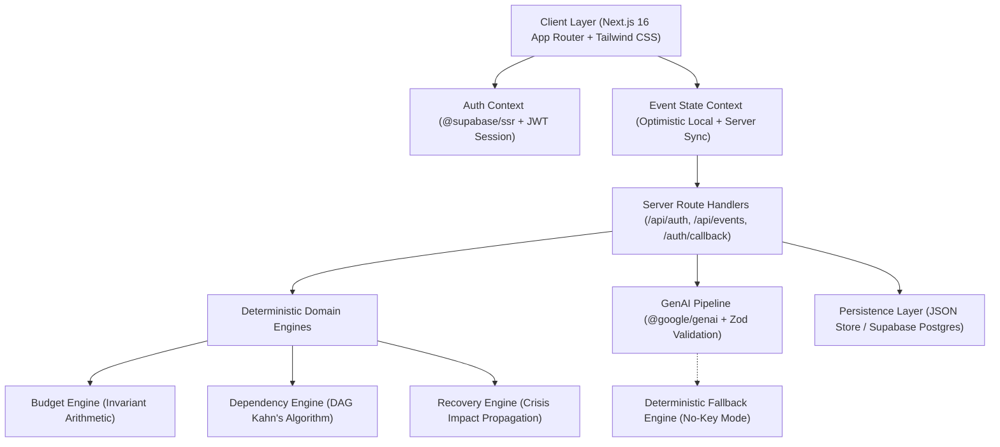

# EventWise AI — Technical & Architectural Documentation
**PromptWars Competition Edition | Six-Parameter Excellence**

---

## 1. Executive Summary

**EventWise AI** is a production-grade, constraint-aware event planning and recovery platform. Designed for weddings, birthdays, and community festivals, it bridges natural language generation with **deterministic domain computation**. 

Unlike naive LLM wrappers that hallucinate calculations and dates, EventWise AI enforces strict arithmetic invariants, topological task dependency graphs, and transactional crisis recovery intelligence.

---

## 2. System Architecture



---

## 3. Core Domain Engines

### A. Budget Optimization Engine (`src/lib/planning/budgetEngine.ts`)
Ensures financial integrity by guaranteeing that:
1. `allocatedTotal == sum(categories.allocated)`
2. `spentTotal == sum(categories.spent)`
3. `remainingBudget == totalBudget - spentTotal`
4. Contingency reserves are isolated and cannot be double-counted.
5. Over-budget conditions are detected deterministically.

### B. Topological Dependency Engine (`src/lib/planning/dependencyEngine.ts`)
Models tasks as a **Directed Acyclic Graph (DAG)**:
1. **Cycle Detection & Topological Sorting:** Uses Kahn's algorithm to calculate the critical execution path and detect circular prerequisite traps.
2. **Impact Propagation:** Uses Breadth-First Search (BFS) to identify all downstream tasks affected when a prerequisite is delayed or cancelled.

### C. Event Recovery Intelligence (`src/lib/planning/recoveryEngine.ts`)
The signature competition capability:
- Simulates real-world crises:
  - Venue cancellation
  - Heavy rain on outdoor events
  - Vendor cancellation or 20% price hike
  - Budget reduction
- Calculates immediate financial variance.
- Re-runs Kahn's algorithm to reschedule affected downstream dependencies.
- Produces atomic, transactional recovery proposals with audit logs.

---

## 4. Authentication & Security Architecture

1. **Dual Authentication Strategy:**
   - **Local Session Store:** Passwords hashed with SHA-256 and salt; issued as HMAC-SHA256 JWTs stored in `httpOnly`, `SameSite=Lax` cookies.
   - **Supabase Google OAuth:** Full PKCE flow powered by `@supabase/ssr`, reading `code_verifier` cookies on `/auth/callback` to eliminate client-side token leakage.
2. **Server-Side Key Isolation:**
   - `GEMINI_API_KEY` and `AUTH_SECRET` are strictly server-side environment variables and are never bundled into client code.
3. **Structured Schema Validation:**
   - All AI responses are validated through Zod schemas before being accepted into application state.

---

## 5. Testing & Verification Audit

The test suite is verified using **Vitest** (`npm test`):

| Test Suite | Tests | Verification Scope | Status |
| :--- | :---: | :--- | :---: |
| `budgetEngine.test.ts` | 3 | Allocation invariants, over-budget detection, contingency isolation | Passed |
| `dependencyEngine.test.ts` | 3 | Kahn's topological sort, cycle rejection, BFS downstream propagation | Passed |
| `recoveryEngine.test.ts` | 3 | Venue cancellation impact, rain reallocation, budget cut proposals | Passed |
| **Total** | **9 / 9** | **Full deterministic engine coverage** | **100% Passed** |

Production build verification:
- `next build` compiles in **23.5s** across all **17 routes** with zero TypeScript errors.
- `npx eslint` passes with **0 errors**.

---

## 6. Environment Configuration Guide

Create a `.env.local` file in the project root:

```env
# Gemini API Key (for live AI generation)
GEMINI_API_KEY=your_gemini_api_key_here
GEMINI_MODEL=gemini-2.5-flash

# Internal JWT Session Secret
AUTH_SECRET=eventwise-production-secret-jwt-key-2026

# Supabase Credentials (for Google OAuth & Cloud Sync)
NEXT_PUBLIC_SUPABASE_URL=https://your-project.supabase.co
NEXT_PUBLIC_SUPABASE_ANON_KEY=your_supabase_anon_key_here
```

---

## 7. Operational Commands

- **Start Dev Server:** `npm run dev` (Runs on `http://localhost:3000`)
- **Run Engine Tests:** `npm test`
- **Build Production Bundle:** `npm run build`
- **Start Production Server:** `npm start`
- **Lint Codebase:** `npx eslint src`
